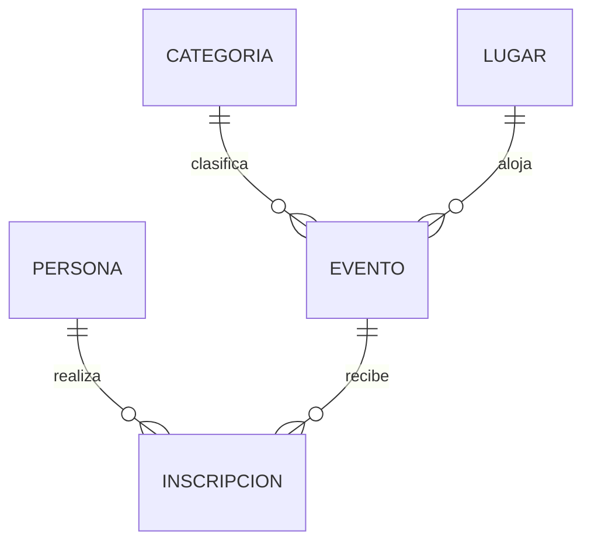

# Agenda Comunitaria — base de datos y API REST

Proyecto académico basado en agenda de eventos comunitarios. Conserva una arquitectura MVC (configuración, modelos, controladores y rutas) y usa Node.js, Express y MySQL/MariaDB.

## Estado de los requisitos

El modelo relacional, los datos sintéticos, la API CRUD y la colección Postman están implementados y probados localmente. El código fuente está publicado en [GitHub](https://github.com/hmnoscarrillo/agenda-comunitaria-api). En `C:\xampp\htdocs\agenda` está preparada una copia local de WordPress con el tema y plugin copiados; falta completar el instalador en el navegador, activar servicios y recopilar evidencias. El despliegue cloud de base de datos y API, las capturas y la grabación personal siguen pendientes.

## Modelo y relaciones



- `persona`: participante; cédula y correo son únicos.
- `categoria`: clasificación temática; nombre único.
- `lugar`: sede física; nombre y dirección únicos, capacidad positiva.
- `evento`: actividad con una categoría y sede. Borrar categoría/lugar referenciado se restringe; actualizar sus claves se propaga.
- `inscripcion`: tabla puente persona-evento, con estado y fecha; la pareja persona-evento es única. Se restringe borrar persona/evento referenciado y se propagan cambios de clave.

Las cinco entidades tienen PK. Se usan tipos atómicos para 1FN. Cada tabla tiene clave primaria de una sola columna y atributos dependientes de toda ella, por lo que cumple 2FN. Datos de categoría, sede y persona viven en sus propias tablas y no se repiten en evento o inscripción; no se guardan atributos transitivos, por lo que el diseño cumple 3FN. La relación muchos a muchos persona-evento se descompone mediante `inscripcion`.

## Instalación y ejecución local

1. Instala Node.js LTS y MySQL/MariaDB.
2. Copia `.env.example` a `.env` y configura host, puerto, usuario, contraseña y nombre de base. `.env` está excluido de Git.
3. Importa `database.sql` con el cliente MySQL. El script (re)crea las tablas del esquema `agenda_comunitaria` y vuelve a insertar los datos de demostración; úsalo solo cuando sea aceptable reinicializar ese esquema.
4. Ejecuta `npm install` y `npm start`.
5. Comprueba `GET http://localhost:3000/health`.

Variables: `PORT`, `DB_HOST`, `DB_PORT`, `DB_USER`, `DB_PASSWORD`, `DB_NAME`, `DB_SSL`. En hosting cloud activa TLS según los parámetros del proveedor y configura las variables en su panel, no en el repositorio.

## Endpoints

Base: `/api`. Cada respuesta JSON sigue `{ success, data?, message?, error? }`.

| Recurso | Colección | Operaciones |
|---|---|---|
| Personas | `/api/personas` | GET lista, GET `/:id`, POST, PUT `/:id`, DELETE `/:id` |
| Categorías | `/api/categorias` | GET lista, GET `/:id`, POST, PUT `/:id`, DELETE `/:id` |
| Lugares | `/api/lugares` | GET lista, GET `/:id`, POST, PUT `/:id`, DELETE `/:id` |
| Eventos | `/api/eventos` | GET lista, GET `/:id`, POST, PUT `/:id`, DELETE `/:id` |
| Inscripciones | `/api/inscripciones` | GET lista, GET `/:id`, POST, PUT `/:id`, DELETE `/:id` |

GET `/api/eventos` incorpora nombres de categoría y lugar. POST y PUT reciben JSON con todos los atributos editables; los IDs de relación deben existir.

Estados: 201 al crear; 200 en lectura, actualización y borrado; 400 para entrada inválida; 404 para ID/ruta inexistente; 409 para duplicados o conflictos referenciales; 500 para error interno. No se devuelven detalles del motor SQL.

### Ejemplo de evento

```json
{
  "categoria_id": 1,
  "lugar_id": 1,
  "titulo": "Feria cultural del barrio",
  "descripcion": "Encuentro abierto de la comunidad.",
  "fecha_inicio": "2026-12-10 10:00:00",
  "fecha_fin": "2026-12-10 12:00:00",
  "estado": "programado"
}
```

La colección importable está en `postman/Agenda Comunitaria.postman_collection.json`. La entidad central elegida para demostrar CRUD es **evento**, porque tiene dos FK directas y es referenciada por inscripciones; representa la mayor cantidad de relaciones funcionales del modelo.

## WordPress

El tema `wordpress-theme/agenda-comunitaria/`, plugin `wordpress-plugin/agenda-api/` y páginas WXR `wordpress-content/agenda-pages.xml` están preparados. El plugin ofrece `[agenda_eventos]` y consulta la API desde el servidor WordPress. Para instalación y pasos pendientes, consulta `wordpress-content/instalacion-wordpress.md`. La copia local está en `C:\xampp\htdocs\agenda`; falta completar el asistente web, importar páginas, activar servicios y verificar presentación.

## Despliegue y entregables externos

El repo de código está publicado en https://github.com/hmnoscarrillo/agenda-comunitaria-api. Falta crear una instancia MySQL cloud y un servicio Node en un proveedor, importar `database.sql`, definir variables en el panel y verificar conexión externa, conteos, JOIN, `/health` y CRUD público.

El taller exige capturas propias y un video de al menos 15 minutos con cámara activa. El guion base de 16–18 minutos está en `wordpress-content/guion-video.md`; graba y personaliza la presentación desde el equipo del estudiante.
