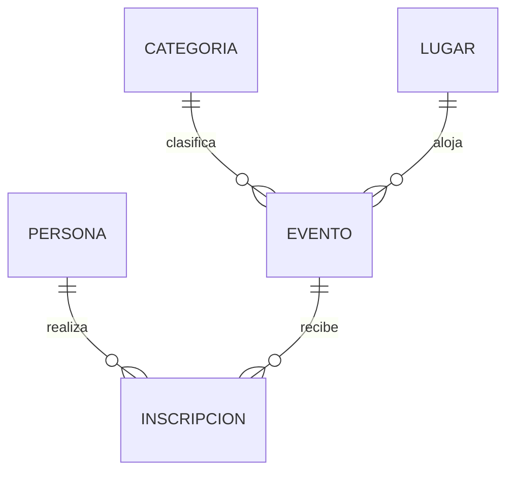

# Agenda Comunitaria — base de datos y API REST

Proyecto académico basado en el tema de agenda de eventos comunitarios. Conserva la arquitectura MVC entregada (configuración, modelos, controladores y rutas) y usa Node.js, Express y MySQL/MariaDB.

## Estado de los requisitos

La estructura de cinco tablas, restricciones, datos sintéticos de ejemplo, API CRUD, validación, colección Postman y material de diseño están preparados en este proyecto. La instancia comprobable actualmente es local. El código fuente se publicará en [GitHub](https://github.com/hmnoscarrillo/agenda-comunitaria-api). La base de datos cloud, la URL pública de API, la instalación completa de WordPress, las capturas y el video siguen pendientes de implementación/verificación.

## Modelo y relaciones



- `persona`: participante; cédula y correo son únicos.
- `categoria`: clasificación temática; nombre único.
- `lugar`: sede física; nombre y dirección únicos, capacidad positiva.
- `evento`: actividad con una categoría y sede. Borrar categoría/lugar referenciado se restringe; actualizar sus claves se propaga.
- `inscripcion`: tabla puente persona-evento, con estado y fecha; la pareja persona-evento es única. Se restringe borrar persona/evento referenciado y se propagan cambios de clave.

Las cinco entidades tienen PK. Se usan tipos atómicos para 1FN. Cada tabla tiene clave primaria de una sola columna y atributos dependientes de toda ella, por lo que cumple 2FN. Datos de categoría, sede y persona viven en sus propias tablas y no se repiten en evento o inscripción; no se guardan atributos transitivos, por lo que el diseño cumple 3FN. La relación muchos a muchos persona-evento se descompone mediante `inscripcion`.

## Instalación y ejecución local

1. Instala Node.js LTS y MySQL/MariaDB.
2. Copia `.env.example` a `.env` y configura host, puerto, usuario, contraseña y nombre de base. `.env` está excluido de Git.
3. Importa `database.sql` con el cliente MySQL. El script (re)crea las tablas del esquema `agenda_comunitaria` y vuelve a insertar los datos de demostración; úsalo solo cuando sea aceptable reinicializar ese esquema.
4. Ejecuta `npm install` y `npm start`.
5. Comprueba `GET http://localhost:3000/health`.

Variables: `PORT`, `DB_HOST`, `DB_PORT`, `DB_USER`, `DB_PASSWORD`, `DB_NAME`, `DB_SSL`. En hosting cloud activa TLS según los parámetros del proveedor y configura las variables en su panel, no en el repositorio.

## Endpoints

Base: `/api`. Cada respuesta JSON sigue `{ success, data?, message?, error? }`.

| Recurso | Colección | Operaciones |
|---|---|---|
| Personas | `/api/personas` | GET lista, GET `/:id`, POST, PUT `/:id`, DELETE `/:id` |
| Categorías | `/api/categorias` | GET lista, GET `/:id`, POST, PUT `/:id`, DELETE `/:id` |
| Lugares | `/api/lugares` | GET lista, GET `/:id`, POST, PUT `/:id`, DELETE `/:id` |
| Eventos | `/api/eventos` | GET lista, GET `/:id`, POST, PUT `/:id`, DELETE `/:id` |
| Inscripciones | `/api/inscripciones` | GET lista, GET `/:id`, POST, PUT `/:id`, DELETE `/:id` |

GET `/api/eventos` incorpora los nombres de categoría y lugar para mostrar datos legibles. POST y PUT reciben JSON con todos los atributos editables; los IDs de relación deben existir.

Estados: 201 al crear; 200 en lectura, actualización y borrado; 400 para entrada inválida; 404 para ID/ruta inexistente; 409 para duplicados o conflictos referenciales; 500 para error interno. No se devuelven detalles del motor SQL.

### Ejemplo de evento

```json
{
  "categoria_id": 1,
  "lugar_id": 1,
  "titulo": "Feria cultural del barrio",
  "descripcion": "Encuentro abierto de la comunidad.",
  "fecha_inicio": "2026-12-10 10:00:00",
  "fecha_fin": "2026-12-10 12:00:00",
  "estado": "programado"
}
```

La colección importable está en `postman/Agenda Comunitaria.postman_collection.json`. La entidad central elegida para demostrar CRUD es **evento**, porque tiene dos FK directas y es referenciada por inscripciones; representa la mayor cantidad de relaciones funcionales del modelo. La colección incluye CRUD, lectura individual y casos inválidos/con conflictos.

## WordPress

Se incluye un plugin de shortcode en `wordpress-plugin/agenda-api/`. Instálalo en `wp-content/plugins/`, actívalo y coloca `[agenda_eventos]` en la página “Consumo de API”. Ajusta `AGENDA_API_BASE_URL` en `wp-config.php` a la URL pública del API (o a `http://localhost:3000` para una instalación local en el mismo equipo). El plugin consulta eventos en el servidor WordPress y presenta una tabla que se adapta a pantallas pequeñas. El plugin no sustituye instalar/configurar WordPress, crear las cuatro páginas, redactar su contenido, añadir banner/video, capturar evidencias ni grabar la presentación.

## Despliegue y entregables externos

Repositorio de código: https://github.com/hmnoscarrillo/agenda-comunitaria-api. Para el despliegue cloud falta crear una instancia MySQL y un servicio Node en el proveedor elegido, importar `database.sql`, definir variables de entorno, permitir la conexión del servicio API al host de base de datos y probar conteos, dos JOIN y `/health` desde fuera. Configura CORS/URL pública solo si el navegador va a llamar al API directamente; el shortcode incluido realiza la consulta desde WordPress.

El taller también exige capturas propias y un video de al menos 15 minutos con cámara activa. Esos materiales deben grabarse desde el equipo del estudiante y guardarse junto con el backup al entregar el comprimido en ISIS.
